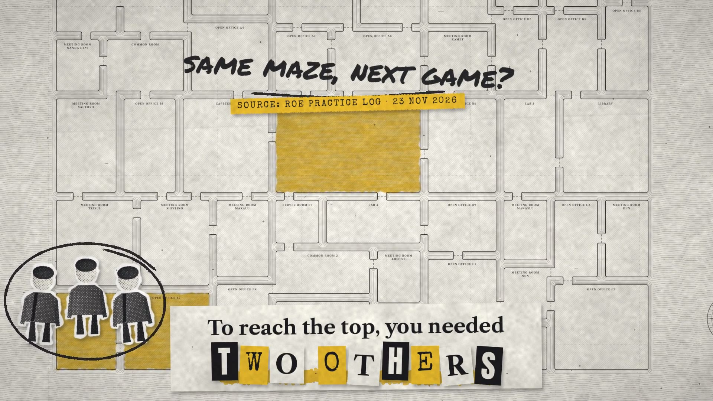

# Maze replay

Turns an ROE Maze log into an interactive replay with findings. One command, one self-contained HTML page, no server.

Live replay: https://sujalpradhan.github.io/maze-replay/ (add `?demo` for the guided tour)

Videos: https://sujalpradhan.github.io/maze-replay/videos.html

- [docs/media/maze-vault-vox.mp4](docs/media/maze-vault-vox.mp4): the vault door story as a paper-map explainer, 36 s
- [docs/media/maze-replay-demo.mp4](docs/media/maze-replay-demo.mp4): the replay itself, 118 s, voiceover and captions



## What the 23 Nov practice log shows

- **The 3-person vault door decided the top scores.** 46 students pressed its pads, it opened 4 times, and 10 solved the task inside. All 10 scored 24 or more, including all 5 players on the top score of 27.
- **Open Office B7, outside that door, is where students spent the most time.** The chat there is mostly "anyone here?".
- **The world was open for 19 hours** and at most 16 students were online at the same moment.
- **21 of 92 scored 0:** 5 never moved, 9 left within 10 minutes, 7 explored without solving anything.
- **The highest score was 27.** Tasks add up to 31, but the bonus task needs an item and 80 written answers are still waiting to be marked.
- **One trap in Open Office A4 was hit 72 times.** Players left 113 notes; 5 warned about traps.

These are observations from the log. The replay shows what happened; it does not prove why.

## Use it

```sh
npm install
node render.mjs path/to/maze-sync/practice-sandbox --out out --title "ROE practice, 23 Nov"
open out/index.html
```

The input is one world folder from `npm run maze:sync` in tds-network-games (`events.jsonl`, `layout.json`, `config.json`, `players.csv`). The output is `out/index.html` (about 1.7 MB for 92 players) and `out/insights.json`.

In the page:

- **Everyone together** starts every player at minute 0, so all runs play side by side. **As it happened** uses the real clock and skips empty hours.
- Click a dot, a feed line or a board row to follow that player. Drag to pan, scroll to zoom, double-click to fit. Space plays and pauses, H toggles the heatmap.
- **Findings** are computed from the log, each with a **Show me** button that jumps the replay to the moment.
- Dots are coloured by final score band. Rings mark solves (green), wrong answers (red), traps (orange) and doors (yellow).

## Privacy

The full page uses game handles (like `calm-otter-07`), never emails. Chat and note text is scrubbed of emails, roll numbers, IP addresses, long numbers and signed tokens (one student pasted a result token into a note). `npm run check` fails if any of those reach the page, and proves it would catch them by planting one of each.

Keep `data/` and `out/` out of git. Share a full build only with staff.

`--anon` makes a page safe to publish: chat and notes are dropped, storyboard quotes are removed, and players become `Player 1` to `Player 92`. Add `--keep-handles` to keep game handles. `npm run site` writes the handles version to `docs/`, which GitHub Pages serves. `npm run check` fails if a line of chat reaches either version.

## Check

```sh
npm run check            # both linked datasets
node test/check.mjs data/some-world
```

Per dataset: event and player counts match `manifest.json` and `players.csv`; final totals match `players.csv`; steps add up to the move events; each player's replayed end position equals their last logged position; solved counts per task and door pressers match a direct count from `events.jsonl`; no identifying text in the page.

## Demo video

The video is made by the page itself. `?demo` plays `demo/storyboard.json`: camera moves, follow shots, captions from the script, callout lists, and cues for voiceover and sound.

```sh
npm run build            # page with the storyboard
npm run demo:sfx         # whoosh, pop, ding, generated in code
npm run demo:voice       # Kokoro voiceover per scene, needs ~/.cache/kokoro
npm run demo             # record with Playwright, mix with ffmpeg
```

`demo/record.mjs` screencasts the page, reads the cue times the page reports, and places each voiceover line and sound effect at its cue. Scene length comes from the voiceover length, so the picture and voice stay in sync without hand timing. Change a line in the storyboard, re-run `demo:voice` and `demo`.

## Paper-map explainer

`demo/vox/` renders the vault door story in a collage map style: the maze is engraved like a sea chart, the camera flies across it, and halftone cut-outs, marker ink, tags and ransom letters land on the beats of the voiceover. Every number comes from the log.

```sh
python3 -m venv ~/.cache/maze-video/venv && ~/.cache/maze-video/venv/bin/pip install numpy opencv-python-headless pillow soundfile
~/.cache/kokoro/venv/bin/python demo/vox/voice.py         # voiceover and word timings from demo/vox/script.json
~/.cache/maze-video/venv/bin/python demo/vox/render.py --sheet   # 12-frame contact sheet
~/.cache/maze-video/venv/bin/python demo/vox/render.py           # docs/media/maze-vault-vox.mp4
```

Fonts (Libre Caslon Text, Permanent Marker, Special Elite, Anton) are read from `~/.cache/maze-video/fonts`, downloaded from google/fonts. Sound effects are synthesised in the script.

## Layout

- `render.mjs`: reads a sync folder, computes positions, events and insights, writes the page
- `viewer/`: page template, styles and replay code (plain JS, canvas)
- `demo/`: storyboard, voiceover and sound scripts, recorder, the rendered videos
- `demo/vox/`: script and renderer for the paper-map explainer
- `docs/`: what GitHub Pages serves: the public page, `videos.html` and `media/`
- `test/check.mjs`: data and privacy checks
- `PROMPT.md`: a prompt for running this on new logs with a coding agent
